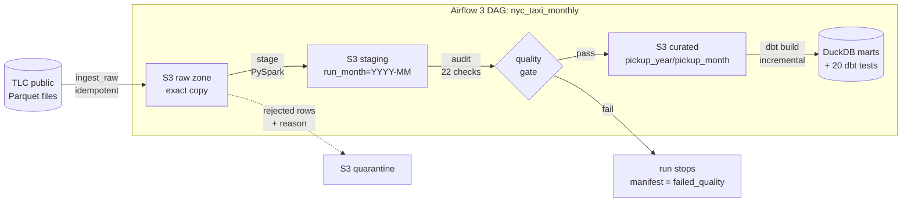

# NYC Taxi Lakehouse Pipeline

[](https://github.com/VishalMankala/nyc-taxi-pipeline/actions/workflows/ci.yml)


A production-style batch pipeline for the [NYC TLC yellow taxi dataset](https://www.nyc.gov/site/tlc/about/tlc-trip-record-data.page)
(about 3M trips a month). Airflow schedules a monthly run. PySpark cleans and enriches the data. A
**write-audit-publish** quality gate blocks bad data, and the result is stored as partitioned Parquet in S3.
dbt then builds tested analytics marts on top.



## What makes it more than a tutorial pipeline

| Problem in real data | How this pipeline handles it |
|---|---|
| Bad data reaching dashboards | **Write-Audit-Publish**: new data is staged, checked with 22 data-quality checks, and published only if every blocking check passes. |
| Re-runs and backfills creating duplicates | **Idempotent** at every step: raw files are skipped if already landed, and publishing uses Spark *dynamic partition overwrite*, so re-running a month replaces exactly that month. |
| TLC renamed and re-typed columns over the years (`Airport_fee`, `passenger_count` int vs double, `cbd_congestion_fee` added in 2025) | **Schema standardization** maps every month onto one canonical schema and logs drift in the run manifest. |
| Stray rows from other years, negative fares, 0-mile trips, 180 mph "trips" | 10 business rules send each bad row to a **quarantine table with a reason**, instead of silently dropping it. |
| Vendors re-sending records | Deterministic `trip_id` (SHA-256 of the natural key) plus de-duplication. |
| Hard-to-debug runs | Each month gets a JSON **run manifest**: row counts, reject reasons, schema drift, every check's result, and timings. |
| Slow analytics | Partitioned, zstd-compressed Parquet sorted by pickup time, plus dbt marts built incrementally per month. |

## Results

Real TLC yellow taxi data, Jan–Mar 2024, run end to end by the **Real TLC data run** workflow on a standard
GitHub Actions runner.

| Metric | Value |
|---|---|
| Months processed | 3 (2024-01 → 2024-03) |
| Trips published to the curated lake | **9,179,196** (2,859,388 · 2,891,567 · 3,428,241) |
| Rows removed by quality rules + dedup (Jan 2024) | 105,236 of 2,964,624 raw rows (**3.5%**) |
| Pipeline time per month (stage → audit → publish) | 37–47 s |
| Storage, one month: CSV vs Parquet | 323 MB vs 50 MB (**6.5x smaller**) |
| Query time, CSV vs Parquet (DuckDB, median of 5 warm runs) | **31.9x faster** median (10.7x–76.6x across 4 queries) |

| Benchmark query | CSV (s) | Parquet (s) | Speedup |
|---|---:|---:|---:|
| daily_revenue | 0.4785 | 0.0343 | 14.0x |
| top_pickup_zones | 0.348 | 0.007 | 49.7x |
| card_tip_rate_by_hour | 0.4498 | 0.0421 | 10.7x |
| long_trips_count | 0.3835 | 0.005 | 76.6x |

## Quickstart

**1. Offline demo (no internet, about 1 minute).** Requires Python 3.11+ and Java 17+.

```bash
pip install -e ".[dev]"
make demo MONTH=2024-01        # synthetic month -> lake -> quality gate -> dbt marts
make test                      # 40 unit + end-to-end tests
```

**2. Real data for one month (downloads about 50 MB).**

```bash
make real MONTH=2024-01
make benchmark MONTH=2024-01   # writes benchmarks/results.md
cat lake/_manifests/yellow_trips/2024-01.json
```

**3. Full stack in Docker: Airflow 3 + Postgres + a local S3 endpoint.**

```bash
docker compose up -d --build
# Airflow UI: http://localhost:8080  ->  unpause nyc_taxi_monthly  ->  Trigger with {"month": "2024-01"}
# Local S3 (moto server) at http://localhost:9000, in-memory: data lasts while the container runs
```

To run against **AWS S3** instead of the local endpoint, set `LAKE_URI=s3://<your-bucket>`, remove `S3_ENDPOINT_URL`,
and provide AWS credentials. No code changes are needed.

## Data-quality gate (22 checks)

Blocking (`error`): non-empty output · reject rate ≤ 10% · unique `trip_id` · no nulls in 6 key columns ·
every pickup inside the run month · dropoff after pickup · duration 1 min to 6 h · distance 0 to 200 mi ·
non-negative amounts · valid location IDs · exactly one partition written.

Recorded but non-blocking (`warn`): zone lookup coverage ≥ 99% (pickup and dropoff) · `total_amount`
matches the sum of its fee components · card tips above 100% are rare · `passenger_count` mostly
populated · every day of the month has trips.

All metrics are computed in **one aggregation pass** over the staged data.

## dbt marts

| Model | Grain | Materialization |
|---|---|---|
| `fct_daily_borough_metrics` | day × pickup borough | incremental (delete+insert per month) |
| `mart_monthly_kpis` | month: median fare, p90 duration, revenue per mile | incremental |
| `mart_zone_hourly_demand` | zone × weekday × hour | table |
| `mart_borough_flows` | origin × destination borough | table |

There are 20 dbt tests, including two reconciliation tests: daily vs monthly revenue must match, and
mart trip counts must equal the rows in the lake.

## Testing and CI

- **40 pytest tests**: every reject rule, schema drift, dedup, enrichment, each quality check, ingest
  failure modes (HTML error page, unpublished month), idempotent re-runs, and failed audits blocking publish.
- **DAG integrity tests** against real Airflow 3.1.
- **CI** (GitHub Actions) has three jobs: lint + tests + two-month end-to-end run + `dbt build`; Airflow DAG
  checks; and a **Docker job that builds the image and runs the whole pipeline against a local S3 endpoint**.

## Repository layout

```
dags/nyc_taxi_monthly.py      Airflow 3 TaskFlow DAG
src/taxi_pipeline/
  ingest.py                   download + validate + land raw files (idempotent)
  transform.py                schema standardization, reject rules, derived columns, enrichment
  quality.py                  22-check quality gate, single aggregation pass
  pipeline.py                 stage / audit / publish (write-audit-publish)
  benchmark.py                CSV vs Parquet benchmark (DuckDB)
  sample_data.py              synthetic TLC-shaped data with planted defects
dbt/taxi/                     staging view, 4 marts, 20 tests
docker/ docker-compose.yml    Airflow + Postgres + local S3 (moto)
docs/DESIGN.md                design decisions and trade-offs
```

More detail: [docs/DESIGN.md](docs/DESIGN.md).
